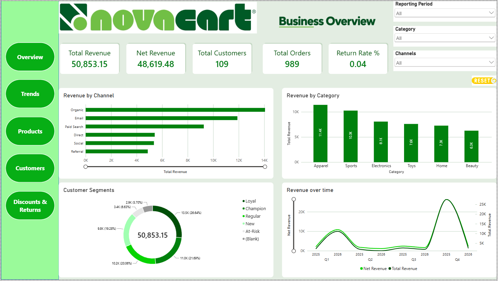
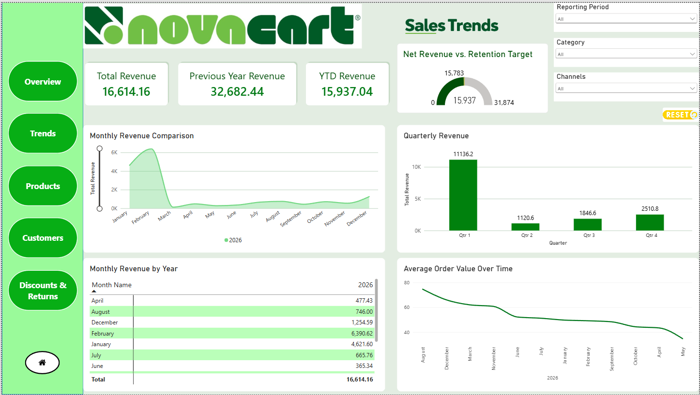
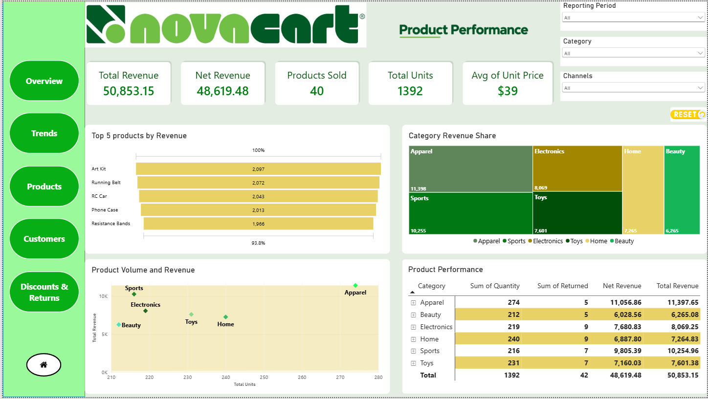
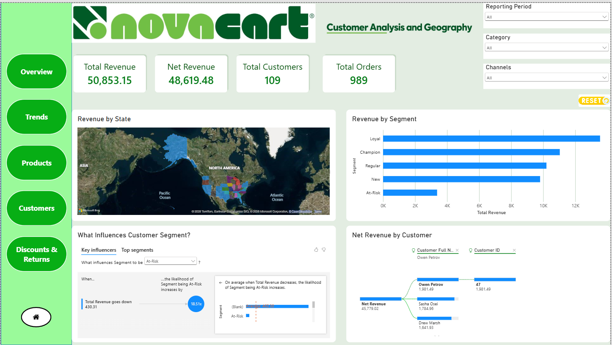
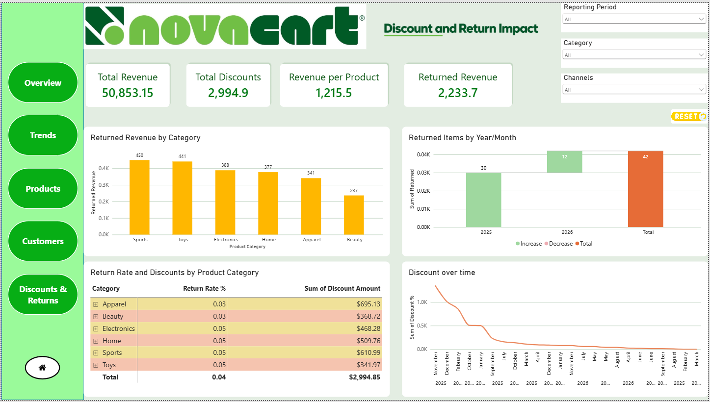

# NovaCart Sales Data Analytics Project

## Project Overview

This project focuses on cleaning, transforming, organizing, and analyzing NovaCart sales data using Microsoft Excel and Power BI.

The objective is to improve data quality, prepare structured datasets, and support sales performance analysis through business intelligence and data visualization.

## Tools & Technologies

- **Microsoft Excel:** Data cleaning, transformation, formulas, and PivotTables
- **Power BI:** Data modeling, analysis, and dashboard development
- **CSV:** Raw dataset storage
- **GitHub:** Project documentation and version control

## Dataset Description

The NovaCart dataset contains information about customer transactions, products, orders, sales channels, pricing, discounts, and returns.

The dataset was organized into three primary tables:

**Customer Data**
- Customer ID
- Customer Full Name
- First Name and Last Name
- Email Address
- Customer Segment

**Product Data**
- Product ID
- Product Name
- Product Category

**Order Data**
- Order Date and Order ID
- Customer ID and Product ID
- Sales Channel
- Quantity and Unit Price
- Discount Percentage
- Line Total
- Returned Status

## Data Cleaning Process

### 1. Data Quality Assessment

- Identified missing values, blank cells, and potential duplicates.
- Checked formatting inconsistencies.
- Created a separate CALC worksheet for data analysis.

### 2. Handling Missing Values

Used statistical methods to identify suitable replacement values:

| Metric | Calculated Value |
|---|---|
| Mode of Order ID | 1044 |
| Mode of Quantity | 1 |
| Average Unit Price | 38.84 |
| Average Discount | 5.5 |
| Mode of Returned | 0 |

Missing product names were filled using the most frequently occurring product within each category.

### 3. Data Transformation

- Separated customer, product, and order information into individual worksheets.
- Used lookup functions to retrieve related records.
- Standardized customer information.
- Formatted dates and currency values.
- Calculated line totals using quantity, unit price, and discount percentage.

### 4. Excel Functions Used

`UNIQUE` `SORT` `FILTER` `XLOOKUP` `VLOOKUP` `IF` `MODE` `AVERAGE` `TEXTBEFORE` `TEXTAFTER` `LOWER` `CONCATENATE`

Additional features included PivotTables, filtering, and number formatting.

## Power BI Analysis

The Power BI project file is included in this repository for further exploration of the NovaCart sales dataset.

Power BI supports analysis of sales performance, product categories, customer segments, sales channels, discounts, and returns.

## 📁 Project Files

The repository contains the following files used for data cleaning, analysis, visualization, and documentation.

| File / Folder | Description |
|---|---|
| `Novacart_Dataset.csv` | Original raw dataset containing sales, customer, product, and order information. |
| `Novacart.xlsx` | Excel workbook containing cleaned and transformed data organized into Customer Data, Product Data, and Order Data worksheets. |
| `Novacart.pbix` | Power BI project containing interactive dashboards for sales, product, customer, and discount analysis. |
| `NOVACART DATA CLEANING.pdf` | Documentation explaining the data-cleaning process, Excel formulas, transformations, and methodology. |
| `Screenshots/Overview.png` | Executive Overview dashboard showing overall business performance. |
| `Screenshots/Sales.png` | Sales Analysis dashboard for evaluating sales trends and performance. |
| `Screenshots/Product.png` | Product Analysis dashboard for exploring product and category performance. |
| `Screenshots/Customer.png` | Customer Analysis dashboard for examining customer behavior and segmentation. |
| `Screenshots/Discounts.png` | Discounts Analysis dashboard for evaluating discount patterns and their relationship with sales. |
| `README.md` | Project overview, methodology, dashboard previews, key business insights, recommendations, and outcomes. |

## 📊 Power BI Dashboard Screenshots

Explore the Power BI dashboards developed for the NovaCart Sales Data Analytics project.

### 1. Executive Overview

### 2. Sales Analysis

### 3. Product Analysis

### 4. Customer and Geography Analysis

### 5. Discounts and Return Analysis

## 💡 Key Business Insights

The NovaCart Sales Data Analytics project focuses on understanding sales performance, customer behavior, product trends, and discount patterns through data cleaning and business intelligence.

### 1. Sales Performance & Channel Analysis
- The initial data analysis identified **Organic as the most frequently occurring sales channel, with 272 records**.
- Sales performance can be evaluated across channels to understand their contribution to overall revenue.
- Monthly sales trends and order values provide opportunities to identify growth patterns and fluctuations in demand.

### 2. Product Performance Analysis
- The analysis identified frequently occurring products across six categories: Apparel, Beauty, Electronics, Home, Sports, and Toys.
- The most frequently occurring products included Joggers, Vitamin C Serum, Wireless Earbuds, LED Lamp, Water Bottle, and RC Car.
- Product-level revenue and sales quantity analysis can help identify top-performing products and opportunities to improve inventory planning.

### 3. Customer Behavior & Segmentation
- Customer records were organized into a structured customer table to support customer-level analysis.
- Customer segmentation provides a foundation for comparing purchasing patterns, revenue contributions, and customer engagement.
- Customer-level insights can support targeted marketing and retention strategies.

### 4. Discounts & Returns Analysis
- The initial data-cleaning analysis identified an average discount value of **5.5**.
- Return-status analysis identified 0 (not returned) as the most frequently occurring value.
- Comparing discounts, sales revenue, and return patterns can help evaluate promotional effectiveness and potential revenue leakage.

### 5. Data Quality & Transformation
- Missing values, duplicate records, and formatting inconsistencies were assessed during data preparation.
- Excel functions such as XLOOKUP, VLOOKUP, IF, UNIQUE, MODE, and AVERAGE were used to clean and organize the data.
- The original dataset was structured into three tables: Customer Data, Product Data, and Order Data, supporting more consistent reporting.

---

## 🎯 Business Recommendations

Based on the exploratory analysis, the following recommendations can support NovaCart's business performance.

### 1. Optimize Sales Channel Performance
- Compare revenue, order volume, and average order value across sales channels.
- Evaluate whether Organic, the most frequently occurring channel, also generates the highest revenue.
- Prioritize marketing investment toward channels demonstrating stronger financial performance.

### 2. Improve Product & Inventory Strategy
- Identify products contributing the highest revenue and sales quantities.
- Use product category performance to support inventory replenishment decisions.
- Monitor lower-performing products to identify opportunities for promotions or assortment optimization.

### 3. Strengthen Customer Retention
- Analyze customer segments based on purchase frequency and revenue contribution.
- Develop targeted marketing campaigns for valuable customer groups.
- Explore repeat-purchase patterns to identify customer retention opportunities.

### 4. Evaluate Discount Effectiveness
- Compare discounted and non-discounted transactions to assess their revenue contribution.
- Identify products and categories where discounts are most frequently applied.
- Review promotional strategies to balance sales growth with profitability.

### 5. Monitor Product Returns
- Track return rates by product category and sales channel.
- Identify products with unusually high return rates.
- Investigate potential product quality, fulfillment, or customer-experience issues.

---

## 🚀 Project Outcome

The NovaCart Sales Data Analytics project demonstrates a practical end-to-end data analytics workflow using Microsoft Excel and Power BI.

### Key Achievements

- **Data Cleaning:** Identified and addressed missing values, formatting inconsistencies, and data-quality issues.
- **Data Transformation:** Organized the original dataset into structured Customer, Product, and Order tables.
- **Excel Analysis:** Applied statistical functions, lookup formulas, PivotTables, and data validation techniques to prepare the dataset.
- **Power BI Development:** Developed a Power BI project covering Executive Overview, Sales, Product, Customer, and Discounts analysis.
- **Business Intelligence:** Established a framework for evaluating sales performance, product trends, customer behavior, and promotional effectiveness.
- **Documentation:** Documented the data-cleaning methodology and organized project files in GitHub for portfolio presentation.

### Skills Demonstrated

`Microsoft Excel` · `Power BI` · `Data Cleaning` · `Data Transformation` · `Data Modeling` · `Exploratory Data Analysis` · `Data Visualization` · `Business Intelligence` · `Sales Analytics`

### Conclusion

This project demonstrates the ability to transform raw business data into structured datasets and analytical dashboards that support data-driven decision-making.

By combining Excel-based data preparation with Power BI reporting, the project provides a foundation for identifying sales trends, understanding customer behavior, evaluating product performance, and exploring opportunities for business improvement.

## Author

**Roopika**

Data Analytics | Microsoft Excel | Power BI
